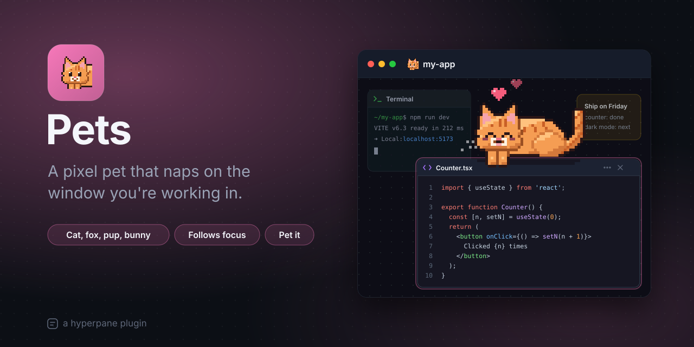

# Pets

A pixel pet that naps on the window you're working in. A cat, a fox, a pup
or a bunny lies along the top of the focused window's header, front paws
hanging over the edge, and when you move to another window it leaps over.
It does nothing useful, and it's good company.

## Features

- **Four pets:** a cat, a fox, a pup and a bunny, each in **four coats**
  (ginger, grey, black, cream: a black fox is a silver fox, a cream one an
  arctic fox) and **three sizes**.
- **Follows your focus:** it sits on the header of whichever window you're
  working in, and when the focus moves it leaps there, facing the way it
  goes, and lands in a puff of dust.
- **Watches you:** its eyes follow the pointer when it's near, and look
  around when it isn't.
- **Alive:** it breathes, sways its tail, blinks, flicks an ear; a bunny
  sniffs.
- **Pet it:** hover and it closes its eyes, pleased; click and it beams,
  blushes and wags, and hearts float up.
- **Naps:** left alone for a while it yawns, nods off and dreams in z's,
  and wakes when the pointer comes close.
- **Part of the canvas:** it pans and zooms with the canvas and rides along
  when its window moves.
- **Stays out of the way:** only the pet above the edge takes clicks; its
  paws leave the header free to drag the window. With reduced motion on,
  it moves without leaping.

## How to use

1. Turn the plugin on in Plugins. The pet appears on the window you're
   working in.
2. Click another window: the pet leaps over.
3. Pick the pet, its coat and its size in the plugin's settings.

To hide it without turning the plugin off, switch off its overlay on the
Pets page in Plugins.

## Settings

| Setting | What it does | Default |
| --- | --- | --- |
| Pet | A cat, a fox, a pup or a bunny. | Cat |
| Coat | Ginger, grey, black or cream, worn each pet's own way. | Ginger |
| Size | Small, medium or large next to the window. It still grows and shrinks with the zoom. | Medium |

## Permissions

| Permission | Why |
| --- | --- |
| `canvas` | To see which window has the focus and where it is, where the pointer is (for its eyes), and to draw the pet over the canvas. |

## Good to know

- The pet hides on a window narrower than itself.
- It's purely decoration: it reads where windows and the pointer are, and
  changes nothing.

## How it works

One overlay (`contributes.overlays`) over the canvas, with the `canvas`
permission: it listens for `view`, `active` (the focused window and its
frame) and `pointer`, and places the pet at the header's top middle. When
`active` names another window, the pet flies there along an arc in canvas
units, so it stays right while the canvas pans. It's drawn on a `<canvas>`
in whole device pixels so it stays crisp, and redrawn only when its pose
changes. Only the pet above the edge is a hit area.

- `src/client/sprite.ts` draws the pets. Each is a few shapes (ellipses,
  polygons, a tail along a curve) laid out for a pose and rasterized: every
  part shaded by where it faces (light from the top left) and ringed with
  an outline, softer where it overlaps what's behind it; then the face,
  stripes, whiskers and the shadow, pixel by pixel. Each coat is a palette.
- `src/client/brain.ts` decides the pose from the time and what the pet
  notices: breath, tail, blinks, gaze, moods (awake, happy, asleep), the
  leap and the landing.
- `src/client/Pet.tsx` is the overlay: where the pet is, the leap, the
  hearts and the z's.

## Develop

    ./build.sh --test

## License

MIT, © 2026 Astralyx. See [LICENSE](LICENSE).
