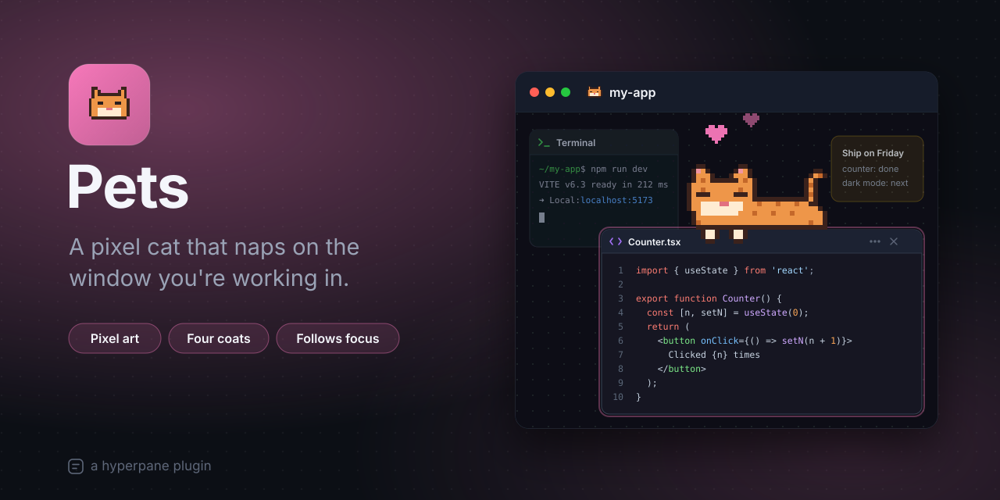

# Pets

A pixel cat that naps on the window you're working in. It lies along the
top of the focused window's header, front paws hanging over the edge, and
when you move to another window it follows. It does nothing useful, and
it's good company.

## Features

- **Follows your focus:** the cat sits on the header of whichever window
  you're working in, in the middle, and moves when the focus does.
- **Part of the canvas:** it pans and zooms with the canvas, so it stays
  on its window wherever you look.
- **Alive, a little:** it swishes its tail now and then and blinks every
  few seconds.
- **Click it** and a heart floats up.
- **Four coats** (ginger, grey, black, cream) and **three sizes**.
- **Stays out of the way:** only the cat above the edge takes clicks; its
  paws leave the header free to drag the window.

## How to use

1. Turn the plugin on in Plugins. The cat appears on the window you're
   working in.
2. Click another window: the cat moves over.
3. Pick its coat and size in the plugin's settings.

To hide it without turning the plugin off, switch off its overlay on the
Pets page in Plugins.

## Settings

| Setting | What it does | Default |
| --- | --- | --- |
| Coat | The cat's colors: ginger, grey, black or cream. | Ginger |
| Size | Small, medium or large next to the window. It still grows and shrinks with the zoom. | Medium |

## Permissions

| Permission | Why |
| --- | --- |
| `canvas` | To see which window has the focus and where it is on the screen, and to draw the cat over the canvas. |

## Good to know

- The cat hides on a window narrower than itself.
- It's purely decoration: it reads where windows are, and changes nothing.

## How it works

One overlay (`contributes.overlays`) over the canvas, with the `canvas`
permission: it listens for `view` and `active` (the focused window and its
frame), places the cat at `toScreen` of the header's top middle, and draws
it on a `<canvas>` in whole device pixels so it stays crisp. Only the cat
above the edge is a hit area, so the paws leave the header's dragging
alone.

The cat is drawn from letters, one per pixel, in `src/client/cat.ts`: a
base pose, a tail laid over it (up or mid-swish), and closed eyes for a
blink. Each coat is a palette for those letters.

## Develop

    ./build.sh --test

## License

MIT, © 2026 Astralyx. See [LICENSE](LICENSE).
